# Parking Citation Management Application
**Developed by KRAMS Consulting Services**  
*Specializing in ServiceNow Solutions, Process Optimization, Workflow Automation, and Operational Analytics*

---

## Overview & Business Problem

Traditional campus parking citation processes rely heavily on manual documentation, repetitive data entry, and disconnected tracking systems—leading to administrative inefficiencies, limited centralized visibility, inconsistent records, and difficulty tracking citation resolution.

Built in **ServiceNow Studio** (`x_1234_parking_c_0`), the **Parking Citation Management Application** centralizes campus parking enforcement, automates visitor owner lookups, provides a self-service Service Portal for students, staff, and guests, and equips leadership with an operational Configurable Workspace and Platform Analytics.

---

## User Stories & Personas

| Persona | User Story |
| :--- | :--- |
| **Security Officers** | Create and record citations electronically so parking violations are accurately documented. |
| **Security Managers** | Review and manage citations, oversee owner lookups, and ensure records are processed appropriately. |
| **Appeals Director** | Review appeal submissions in a dedicated workspace and issue decisions (*Upheld*, *Reduced*, *Dismissed*). |
| **Students & Staff** | View personal vehicle citations, read policy guides, and submit appeals via the Service Portal. |
| **Guests / Visitors** | Retrieve citations or submit appeals without needing a campus account. |

---

## System Architecture & Components

### 1. Core Data Model & Security
* **Custom Tables:** Citation, Appeal, Owner Lookup, Vehicle, and Violation Type tables built in ServiceNow Studio.
* **Server-Side Logic:** Business Rules for automated deadline calculations (14-day appeal window, 11-day reminder date) and field validation.
* **Governance:** Granular role-based permissions and Access Control Lists (ACLs) protecting student PII while enabling cross-table workflow execution.

### 2. Flow Designer Automation (8 Flows)
* `Citation Issued`: Populates fine amounts from the violation table and triggers initial student/staff email notices.
* `Visitor Owner Lookup`: Checks for active lookups on guest plates to prevent duplicates and routes tasks to Campus Safety.
* `Owner found on citation`: Links identified visitor plates to campus user profiles and dispatches citation notices.
* `Appeal Opened`: Transitions parent citations to *Under Appeal*, flags `Appealed = true` to block duplicate appeals, and routes to the Appeals Director.
* `Appeal Decided` & `Reduced fine applied`: Updates citation states (*Closed* or *Voided*), notifies the appellant, and alerts management for fine adjustments.
* `Appeal Deadline Reminder` & `Close Expired Citations`: Scheduled flows managing 11-day reminders and 14-day automatic closures.

### 3. Notifications & Email Templates
* **Email Templates:** Custom `Campus Safety Email Template` and `New Parking Template` utilizing dot-walked variables (e.g., `${citation.number}`, `${vehicle.plate}`).
* **Automated Notifications:** `Appeal Awaiting Decision`, `Appeal Deadline Reminder`, `Appeal Decision Notification`, `Appeal Received Notice`, `Citation Fine Reduction`, `Citation Issued Notice`, `Citation Voided Notice`, `Owner Lookup Assigned`, and `Parking – Fine reduced`.

### 4. Service Portal & Knowledge Base
* **Self-Service Portal:** Custom pages, widgets, Record Producers, Catalog Builder items, and a dynamic campus announcement banner.
* **Knowledge Base Articles:**
  * *How to Do a Citation (Security)*
  * *How to Appeal a Citation (Security)*
  * *How to Do a Citation (Students/Guests/Staff)*
  * *How to Appeal a Citation (Students/Guests/Staff)*

### 5. Configurable Workspace & Analytics
* **UI Builder Workspace:** Streamlined internal workspace for Security Managers and the Appeals Director to review queues and resolve appeals.
* **Platform Analytics:** Operational dashboards and reporting tracking citation volume, appeal outcomes, and SLA compliance.

---

## ServiceNow Technology Stack

* **ServiceNow Studio** (Scoped Application Development)
* **Flow Designer** & **Scheduled Script Executions**
* **Service Portal**, **Catalog Builder**, & **Record Producers**
* **UI Builder** (Configurable Workspace)
* **Business Rules**, **Roles**, & **ACLs**
* **Knowledge Management** & **Platform Analytics**

---

## Implementation Roadmap & Future Improvements

### Phased Delivery
1. **Phase 1 — Core Operations (MVP):** Centralized citation creation, record tracking, violation management, and RBAC.
2. **Phase 2 — Appeals & Communication:** Self-service portal appeals, visitor owner lookups, automated notifications, and decision workflows.
3. **Phase 3 — Parking & Visitor Management:** Expansion into parking permits, visitor registration, and event parking.

### Future Enhancements
* **Enterprise Integrations & Analytics:** Cross-departmental system integrations and advanced predictive reporting.
* **Mobile Field Operations:** Mobile citation issuance with real-time photo uploads for officers on patrol.
* **Financial Services Integration:** POS/cashier integration, electronic payment gateways, and automated financial reconciliation.

---

## Installation (Import via ServiceNow Studio)

1. Fork or copy this repository URL.
2. In your ServiceNow instance, navigate to **System Applications > Studio**.
3. Select **Import From Source Control**.
4. Paste the repository URL, choose the `main` branch, and enter your Git credentials / Personal Access Token.
5. Once imported, open **Flow Designer** to verify all 8 flows are **Active**.

---

## User Interface & Portal Walkthrough

### Security Officer Landing Page
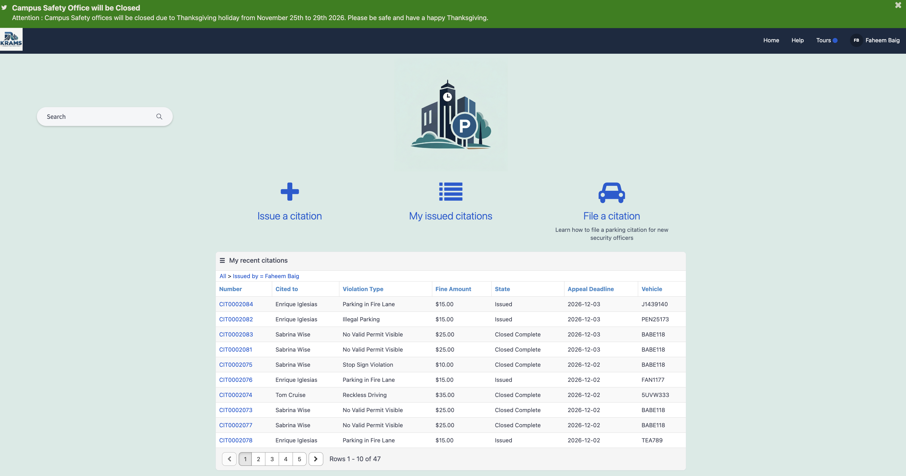

### Citation Form
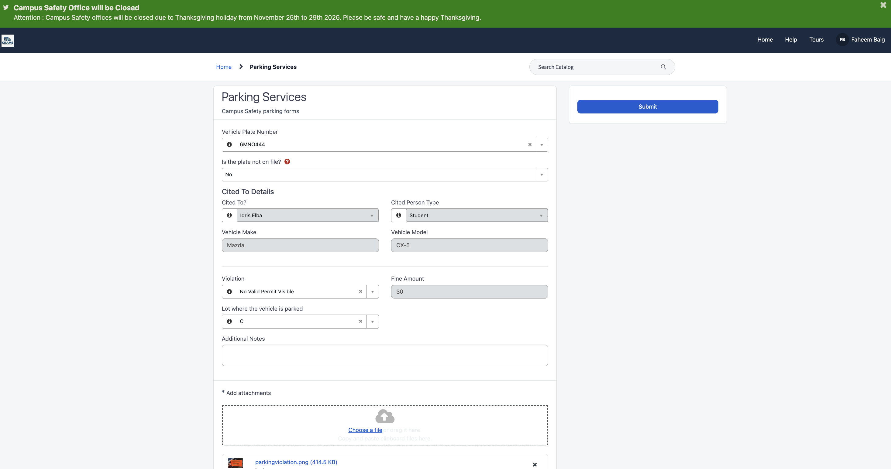
Record Producer showing citation form auto-populated fine/violation details.

### Citation Form Submitted
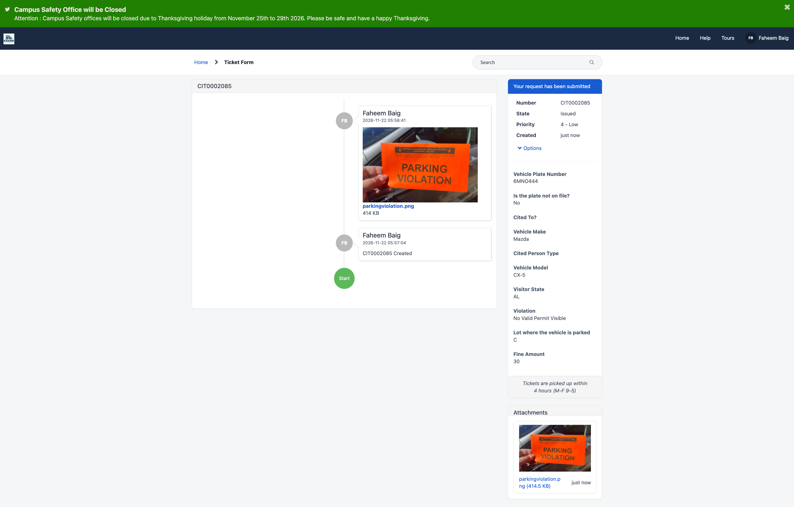

### Student Landing Page
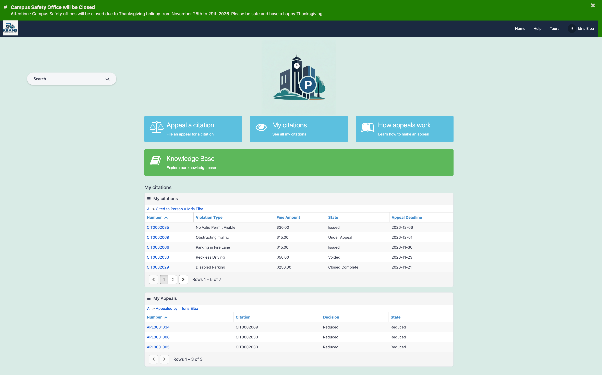
Record Producer showing active citations and auto-populated fine/violation details.

### Appeal a Citation Knowledge Base
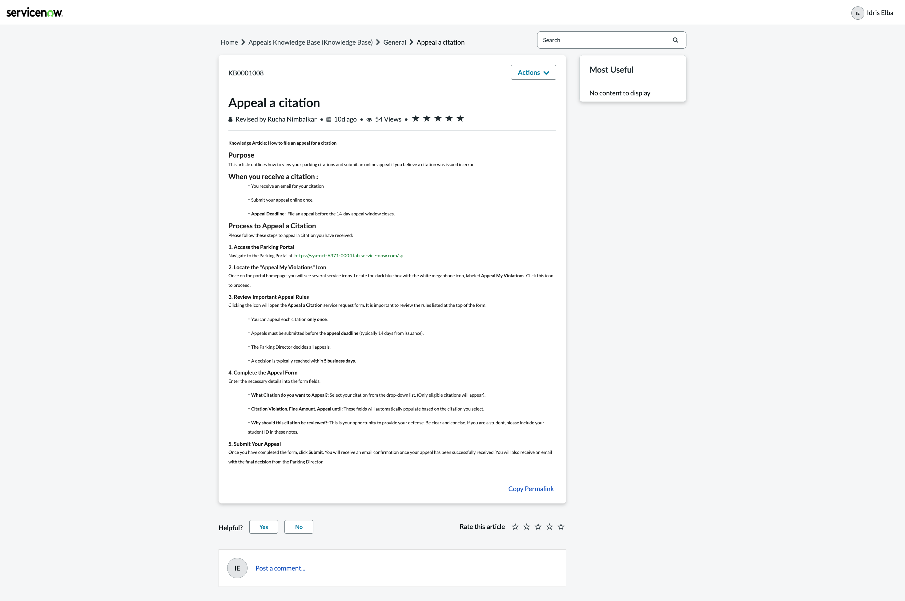

### Appeal a Citation Form
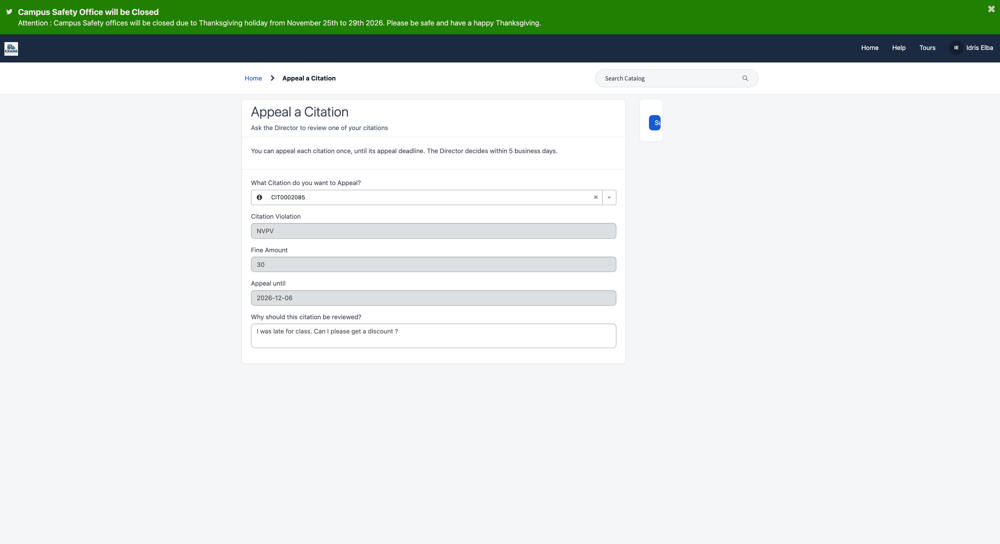

### Appeal a Citation Form Submiited
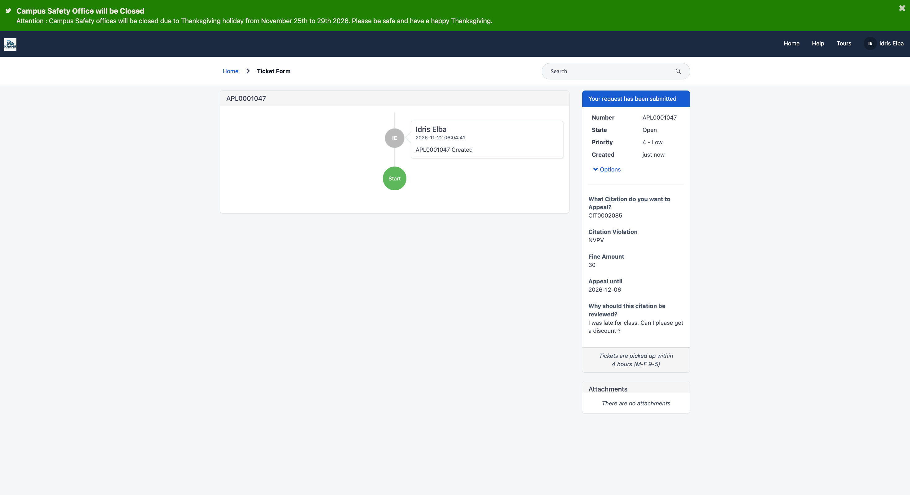

### Director Workspace
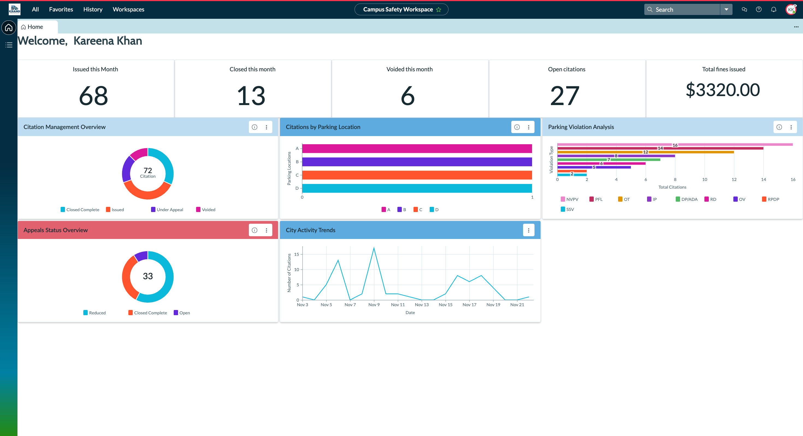
Configurable Workspace view showing analytics.

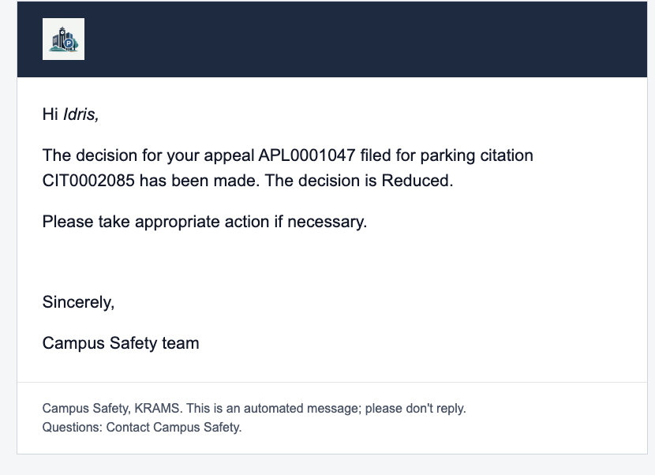
Appeal Decision

### Automated Email Notifications
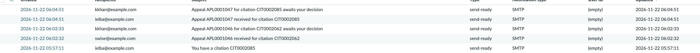
Outbound citation and appeal emails.

### Automated Citation Received Email Notifications
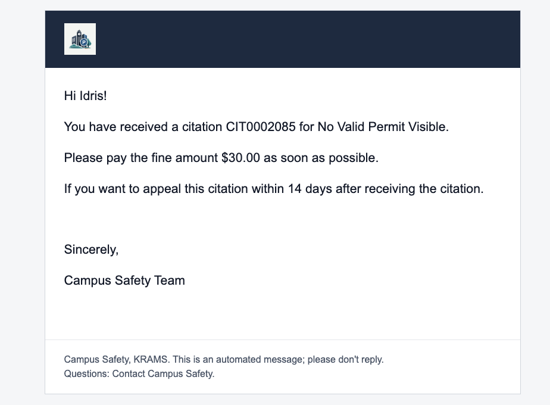
Outbound citation received email.

## KRAMS Consulting Services Team

* **Maya Burgos** — *Business Process Analyst / Scrum Master*  
  Agile coordination (Visual Task Board), UAT & defect management, Service Portal & Record Producers, Workspace & Platform Analytics.
* **Abdullah Kamal** — *UI Designer / Developer* ([LinkedIn](https://linkedin.com/in/abdullahk5))  
  Service Portal UI/UX, form validations, mandatory field logic, and Knowledge Base co-development.
* **Adetola Adeniran** — *Solution Architect / Developer*  
  Application architecture, data modeling, Workspace UI Builder configuration, Business Rules, Flow Designer, and Roles/ACLs.
* **Rucha Nimbalkar** — *Product Owner / Developer*  
  Requirements & backlog prioritization, custom tables, Business Rules, Flow Designer workflows, notifications, and Knowledge Base co-development.
